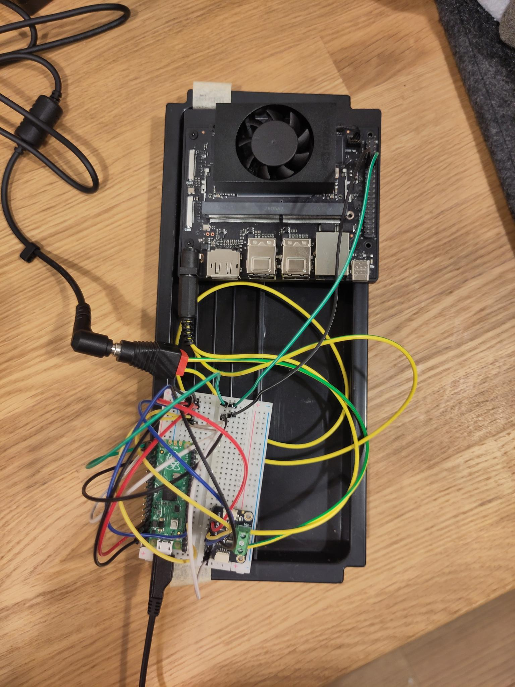
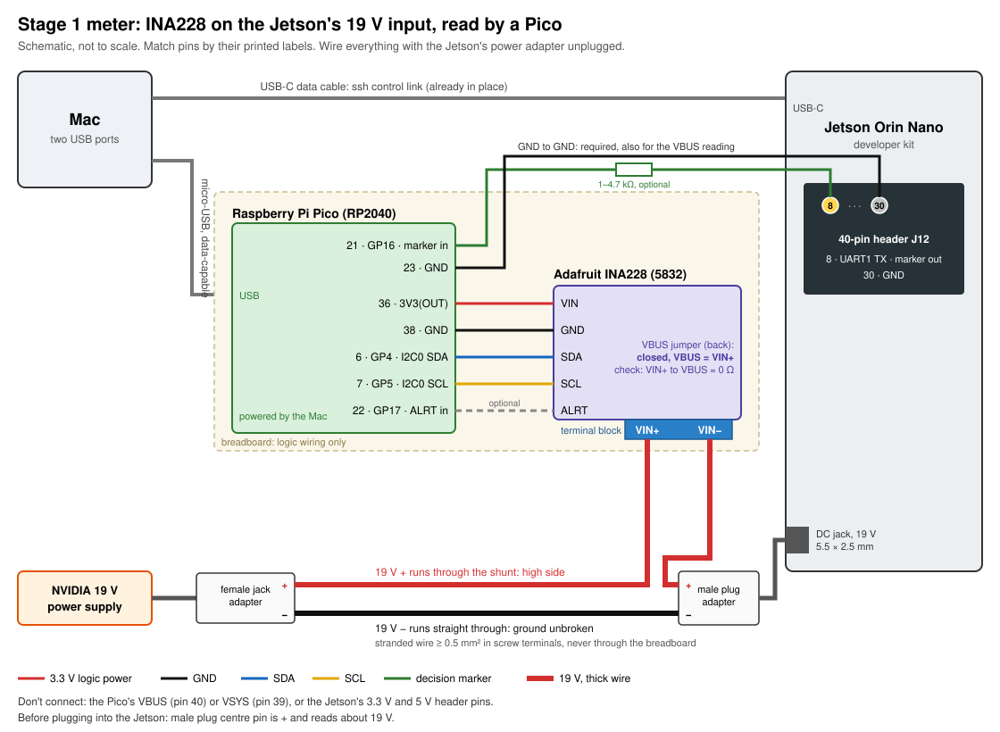
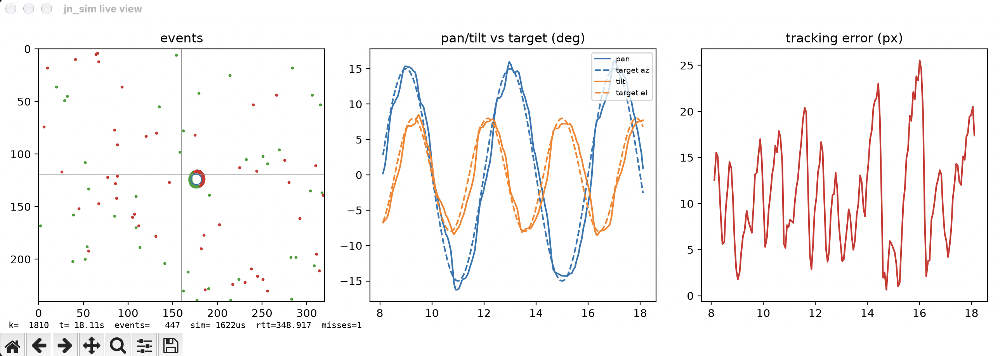
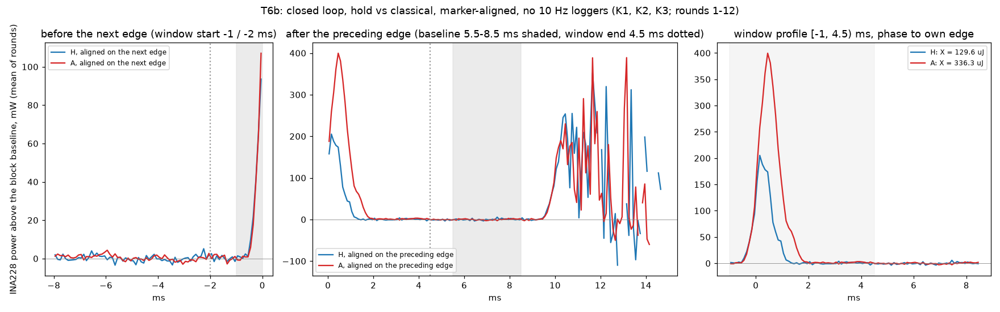

# jetson_neuro

### Energy per control decision: event-vision closed-loop control on a Jetson Orin Nano


> [!NOTE]
> **Status, November 2026.** 🟢 The simulator, the measurement rig and the
> classical controller (A) are built and measured. ⚪ The network-based
> controllers (B–D), the clock-frequency sweep and the fault study are planned.
> Full roadmap in [§5](#5-status-and-roadmap).

## Abstract

Energy figures for edge AI are often given for the chip or the module, on a
benchmark loop. A robot pays for something else: every *control decision* in
a closed loop, at the power input of the whole board. This project builds that
measurement. A simulated pan/tilt camera tracks a moving target from
event-camera input; the controller runs on an NVIDIA Jetson Orin Nano and
answers every 10 ms; a power monitor on the board's 19 V input, synchronised to
a marker the controller sends at each decision, attributes energy to
individual decisions and resolves differences of about 10 µJ per decision.

For a classical event-cluster tracker with a Kalman filter and PID, one
decision costs **207 µJ [195, 219]** above a no-op controller, out of
**63.6 mJ** the board spends per decision: **0.33 %**. The idle board is
99.3 % of the total, and the loop's own harness (link, event decoding) costs as
much as the algorithm. On the same idle board, the CPU/GPU rail reads 0.44 W
and the 19 V input 6.36 W, so where the measurement boundary is drawn changes
the answer by a factor of 14.

## Key findings

1. **At system level, the algorithm is a small part of the energy.** Controller
   A's algorithm is 0.33 % of the board's energy per decision; the idle floor is
   99.3 %.
2. **The harness is as large as the algorithm.** Receiving and decoding the
   events and answering with a no-op command costs 208 µJ [179, 237] per
   decision, against A's 207 µJ.
3. **The boundary matters by 14×.** At idle, 0.44 W on `VDD_CPU_GPU_CV`,
   4.54 W on the module input `VDD_IN`, 6.36 W at the board's 19 V input
   (`traces/stage1_20261030/report.md`, Part 4).
4. **The board's own sensor can't see a decision.** The on-board INA3221 has
   40 mW steps and about 0.6 s of smoothing. A board-level INA228 plus a
   per-decision marker resolves 0.1 ms of one busy CPU core as +28 µJ [+23, +34].
5. **Measurement hygiene decides the precision.** Two 10 Hz loggers running
   during the blocks more than tripled the round-to-round spread; a
   pre-registered rerun without them gave ±5.9 %.

## 1. Motivation

The long-term question is whether learned and spiking controllers can beat a
classical one on energy per decision on conventional edge hardware, and what
it costs them in tracking quality and robustness. The goal the project works
toward:

> On one Jetson Orin Nano, classical, conventional-network and spiking-network
> controllers run in the same closed event-vision loop. Each is characterised
> for *energy per control decision*, latency and tracking quality across event
> load and clock frequency, with energy measured on the board's power rails
> inside a declared measurement boundary. Under software-injected compute
> faults, each is also characterised for how its tracking degrades and what
> detecting the faults costs in energy.

Four controller families run in the same loop (`docs/exploration.md` §5):

| | Family | Runs on |
|---|---|---|
| **A** | classical: event-cluster tracker, Kalman filter, PID | CPU, numpy |
| **B** | small CNN on an event representation | GPU, TensorRT |
| **C** | spiking network, time-stepped | GPU, PyTorch CUDA |
| **D** | the same spiking network, event-driven | CPU |

A comes first. It is the baseline the learned controllers have to beat, and
it is what this release measures; B–D are planned.

## 2. Setup

<table>
<tr>
<td></td>
<td></td>
</tr>
<tr>
<td><b>Figure 1a.</b> The rig. Top: the Jetson Orin Nano developer kit. Bottom: the Raspberry Pi Pico and the INA228 breakout (green terminal block) on a breadboard. The 19 V supply passes through the INA228's shunt to the board's DC jack; the green and black jumpers carry the marker (header pin 8) and ground from the Jetson to the Pico.</td>
<td><b>Figure 1b.</b> Wiring of the board-level meter. The INA228 sits on the high side of the 19 V input; the Pico reads it over I²C, is powered by the host's USB, and timestamps the marker edges on the same clock. Details: <a href="docs/stage1_wiring.md"><code>docs/stage1_wiring.md</code></a>.</td>
</tr>
</table>

**The loop.** A simulator on a laptop (`src/jn_sim`) renders a pan/tilt camera
looking at a moving target and turns it into the output of a 320 × 240 event
camera: per-pixel contrast thresholds, a refractory period and shot noise. The
gimbal is a second-order servo with a 10 ms dead time. Every 10 ms the
simulator sends that period's events to the controller over TCP on the USB-C
link; the controller has 5 ms to answer with a pan/tilt setpoint. Everything
is specified in `docs/spec_sim.md`.



**Figure 2.** The simulator's live view, here with the `centroid` reference
controller: one period's events with the target at the image centre (left),
camera pan and tilt against the target (middle), tracking error in pixels
(right). `centroid` lags the target; controller A cuts this error about 13×.

**The measurement.**

- **Boundary:** the board's 19 V DC input, so the carrier board, the module,
  the fan and the USB link are all inside it.
- **Meter:** an Adafruit INA228 with a 15 mΩ shunt, read by a Raspberry Pi
  Pico at 926 samples/s. The Pico's PIO timestamps each conversion-ready
  signal.
- **Marker:** at the start of every decision the controller writes one byte to
  the Jetson's UART on header pin 8. The Pico timestamps its start bit on the
  same clock, so every power sample can be placed relative to every decision.
- **Board:** 25 W mode at default DVFS, desktop and maintenance services
  disabled, radio off (`docs/setup.md`).

## 3. Method

A single decision is invisible in the raw trace: the board's own activity
varies by 114 mW (sd) over 10 ms windows, against a signal of about 20 mW.
So the analysis folds thousands of decisions onto the time since their marker
edge:

- **Per block**, the excess energy X is the power above the same period's
  quiet part ([5.5, 8.5) ms after the edge), integrated over [−1, 4.5) ms.
  Using each period's own baseline cancels slow drift.
- **Dynamic energy**, E_dyn = X_controller − X_hold: the difference against a
  no-op controller (`hold`) that receives the same kind of input and returns a
  fixed command, paired within each round.
- **Design:** rounds of three 60 s blocks (idle, `hold`, the controller), the
  order cycling through all six permutations; a fresh controller process per
  block, pinned to one core; no logging during the blocks; the design and the
  analysis written down before the first block (`traces/t6b_20261102/raw/plan.txt`).
- **Validation:** synthetic decisions of one busy core for 0.1, 0.3 and 1 ms
  come out linear in the busy time, at 249 mW per core; 0.1 ms reads +28 µJ
  [+23, +34] (`traces/stage1_20261030/`).

## 4. Results: controller A

Controller A (`src/jn_sim/classical.py`) seeds a cluster from a coarse grid of
ON events, follows it with a gated mean-shift, filters the target's angle with
a constant-velocity Kalman filter per axis, and commands the filter's
prediction across the loop's delay plus a PID on the image error. It knows the
camera's pose only from a model of the servo it commands. Design:
`docs/spec_ctl_a.md`; full results: `docs/ctl_a.md`.

**Tracking** (RMS angular error in degrees, lockstep, one 30 s episode per
seed; seeds 5–9 were held out from tuning; target in view 100 % of the time in
every run):

| Scenario | `centroid`, seeds 0–4 / 5–9 | **A**, seeds 0–4 / 5–9 |
|---|---|---|
| sine | 2.67 / 2.64 | **0.20 / 0.21** |
| random | 2.49 / 2.75 | **0.20 / 0.21** |
| step, from the first jump | 3.42 / 3.43 | **1.17 / 1.39** |
| step, whole episode¹ | 4.26 / 4.34 | **2.84 / 2.92** |

¹ The step scenario's first 2 s are unobservable for any controller: the
target sits still off-centre until the first jump, so it produces no events.

**Timing on the Jetson** (`traces/t5_20261102/`): 0.47 ms per decision at the
median and 0.56 ms at p99, against the 5 ms deadline. The rare slow steps
(up to 2.3 ms in the timing runs, and 4.1 ms twice in 72,000 steps of the
energy session) are attributed to Python garbage collection.

**Energy per decision** (19 V input, 100 Hz control, 12 pre-registered
rounds, `traces/t6b_20261102/`; 95 % CIs):

| | Energy per decision |
|---|---|
| Idle board | 63.21 mJ [63.18, 63.23] |
| + harness (link, decode, no-op controller) | +0.21 mJ [0.18, 0.24] |
| + controller A's algorithm, E_dyn(A) | **+207 µJ [195, 219]**, ±5.9 % |
| **Total, E_tot(A)** | **63.63 mJ [63.59, 63.66]** |



**Figure 3.** Average power above each period's quiet baseline, aligned on the
decision's marker edge, for the no-op controller `hold` (H, blue) and
controller A (red), 12 rounds of 60 s. Right: the integration window
[−1, 4.5) ms. The areas are X_H = 130 µJ and X_A = 336 µJ; their difference
is A's dynamic energy. The rise just before 0 ms is the observation arriving;
A's step is over about 2 ms after the edge.

- While it computes, A draws about 440 mW above `hold`, about 1.8× the power of
  a busy loop on one core. Memory traffic from numpy is the leading guess, not
  verified.
- A first energy session with 10 Hz loggers running gave +217 µJ ±15 %
  (`traces/t6_20261102/`). Without the loggers the round-to-round spread fell
  from 67 to 19 µJ, as the pre-registered confirmation required.

## 5. Status and roadmap

🟢 done · 🟡 partly done · ⚪ planned

| | Part | Where |
|---|---|---|
| 🟢 | Event-camera simulator, gimbal plant, wire protocol, live viewer | `docs/spec_sim.md`, `docs/sim.md` |
| 🟢 | Closed loop with the controller on the Jetson, 0 misses in 60 s | `traces/board_20261026/` |
| 🟢 | Board-level energy meter with a per-decision marker | `docs/stage1_wiring.md`, `traces/stage1_*/` |
| 🟢 | Measurement protocol: paired, counterbalanced, pre-registered rounds | `docs/ctl_a.md` §9 |
| 🟢 | **Controller A**: tracking, Jetson timing, energy per decision | `docs/ctl_a.md` |
| 🟡 | On-board INA3221 cross-check: works for totals, too coarse per decision | `docs/exploration.md` §4 |
| 🟡 | Measurement tooling: works, but as per-session scripts with this rig's settings | `traces/<session>/scripts/` |
| 🟡 | Simulator on Linux: manual install steps, untested | §7 |
| ⚪ | Open-loop replay, so every controller gets identical input | `docs/spec_ctl_a.md` T9 |
| ⚪ | Clock points: energy across locked CPU and GPU frequencies | `docs/exploration.md` §3 |
| ⚪ | Fault study: bit flips in controller state, and what detecting them costs | `docs/exploration.md` §5 |
| ⚪ | Controller B: CNN on event representations, TensorRT | `docs/exploration.md` §5 |
| ⚪ | Controllers C and D: one spiking network, time-stepped on the GPU and event-driven on the CPU | `docs/exploration.md` §5 |
| ⚪ | Harder scenes: textured background, distractors | `docs/spec_sim.md` §1 |

## 6. Limitations

- One scene stage (a single bright disc on a uniform background), one
  trajectory for energy (`track-sine-v1`), one clock point (default DVFS; the
  controller's core ran at 729.6 MHz).
- Closed loop: A receives 158 events per decision against the no-op's 404, so
  E_dyn(A) includes a smaller decode cost and understates A's own compute by
  that amount. Open-loop replay would remove it; not done.
- A knows the camera's pose only from a model of the servo it commands, not
  from a sensor (`docs/spec_ctl_a.md` R3).
- Python and numpy on CPython, not an optimised implementation.
- The meter's absolute scale rests on the INA228's and the shunt's datasheet
  accuracy; it wasn't checked against a reference load.
- `VDD_IN`, the module's on-board sensor, can't resolve differences of this
  size.

## 7. Reproducing

**The simulator** (Python 3.12, numpy; matplotlib for the live viewer; no
hardware needed):

```sh
# macOS (Homebrew python@3.12)
sh scripts/setup_sim_env.sh
# other systems: the same steps by hand
python3.12 -m venv .venv
.venv/bin/python -m pip install -r requirements.lock
.venv/bin/python -m pip install --no-deps -e .

MPLBACKEND=Agg .venv/bin/python -m pytest -q
.venv/bin/jn-sim run --scenario track-sine-v1 --controller inproc:classical --mode lockstep --duration 5
.venv/bin/python scripts/eval_controllers.py classical --seeds 0 --scenarios track-sine-v1
```

The setup script supports macOS only; the manual steps are untested on Linux.
`docs/sim.md` is the operator's guide (realtime runs, the viewer, running the
controller on another machine). The controller server `jn-sim ctl` has no
authentication; it binds to 127.0.0.1 unless told otherwise.

**The energy analysis, from the published raw data** (no hardware):

```sh
cd traces/t6b_20261102
for k in K1 K2 K3; do gzip -dc raw/$k.bin.gz > raw/$k.bin; done
MPLBACKEND=Agg ../../.venv/bin/python scripts/t6_analyze.py raw/rerun K1 K2 K3
# raw/rerun.json equals the published raw/result.json
```

**A measurement on hardware** needs the rig in `docs/stage1_wiring.md` and the
board configuration in `docs/setup.md`. The measurement scripts are the
per-session copies in `traces/<session>/scripts/`, with this rig's host alias,
device IDs and temp paths built in; a single configurable tool doesn't exist
yet.

## Repository layout

```
README.md             this file
LICENSE               MIT
docs/
  exploration.md      simulation, staged measurement, algorithms, literature, plan
  spec_sim.md         simulator spec: requirements, protocol, tasks
  sim.md              simulator operator's guide
  spec_ctl_a.md       controller A spec: requirements, energy protocol, tasks
  ctl_a.md            controller A: running, tuning, tracking, timing, energy
  stage1_wiring.md    wiring of the INA228 and Pico power meter
  setup.md            board and session configuration used for the measurements
  img/                figures referenced from the docs
scripts/
  setup_sim_env.sh    builds the simulator venv on macOS
  eval_controllers.py tracking evaluation over scenarios × seeds
scenarios/            named, versioned run configurations (track-*-v1)
src/jn_sim/           simulator, controllers, wire protocol, CLI (`jn-sim`)
tests/                pytest suite; run with MPLBACKEND=Agg
traces/               raw data, scripts and reports per session (see traces/README.md)
```

## Hardware

```
Jetson Orin Nano Super developer kit, 8 GB · 25 W power mode
L4T R39.2.1 / JetPack 7.2.1 · CUDA 13.2 · TensorRT 10.16
Adafruit INA228 (product 5832, 15 mΩ shunt) on the 19 V input
Raspberry Pi Pico (RP2040), MicroPython 1.29.0, as the logger
```

Board configuration and the per-session checklist: `docs/setup.md`. Wiring:
`docs/stage1_wiring.md`.

## Provenance

The code was developed in a private repository, and the traces and docs cite
its commit SHAs (`0c397e1`, `cbcae21`, …). Those commits aren't in this repo's
history. The link is the `src/` tree:

- controller A's final evaluation (`docs/ctl_a.md` §5–§7, code `ce1bda2`)
  and the board sessions T5, T6 and T6b (code `0c397e1`) ran `src/` tree
  `8a190b7ca99ad4fedcde25b8c0194ba7767dd413`, which is this repo's `src/`.
  Check it with `git rev-parse HEAD:src`; `traces/t6b_20261102/raw/board_src_md5.txt`
  also lists the board's files by md5;
- controller A's tuning grid (`docs/ctl_a.md` §4) ran an earlier
  `classical.py`, before the review fixes;
- sessions up to 31 Oct ran tree `d096a60`: the same code without controller A
  (`classical.py` absent, and the 8-line `classical` branch in `testctl.py`).

## Notes on the data and the docs

- **How the work was done.** The sessions were planned, run and reported with
  AI coding agents, under the author's direction; the author did every
  physical step and approved the board's `sudo` commands. Reports call these
  roles "the planner", "the bench agent" and "the user". Findings are tagged
  **V** (checked and seen), **V-user** (observed or reported by the author)
  and **NV** (not verified).
- **Models used in development:** Claude Opus 5.5 and Claude Opus 4.8
  (Anthropic), and GPT-6 Astra (OpenAI), through the Kiro IDE.
- **References to private notes.** Docs and reports cite `SETUP_NOTES.md`
  (the private rig notebook: board setup, troubleshooting, the session
  checklist) and `hardware_demo_plan.md` (the private project plan). Neither is
  published; `docs/setup.md` summarises the parts the measurements depend on.
  Session briefs ("the brief", bare `§N` in reports) and one internal code
  review are not published either.
- **`runs/…` paths.** Reports were written in a gitignored `runs/<session>/`
  folder and copied to `traces/<session>/`; read `runs/<session>` as
  `traces/<session>`. The evaluation and tuning runs cited in `docs/ctl_a.md`
  are summarised in `traces/ctl_a_eval_20261101/`.
- **Redactions and removals** are listed in `traces/README.md`.

## Citing

```bibtex
@misc{buchholz2026jetsonneuro,
  author       = {Emanuel Buchholz},
  title        = {jetson\_neuro: Energy per Control Decision for Event-Vision
                  Closed-Loop Control on a Jetson Orin Nano},
  year         = {2026},
  howpublished = {\url{https://github.com/MrNotSure/jetson_neuro}}
}
```

## Licence

MIT, see `LICENSE`. Dependencies (numpy, matplotlib, pytest and their
requirements, pinned in `requirements.lock`) are under permissive licences and
not vendored.
