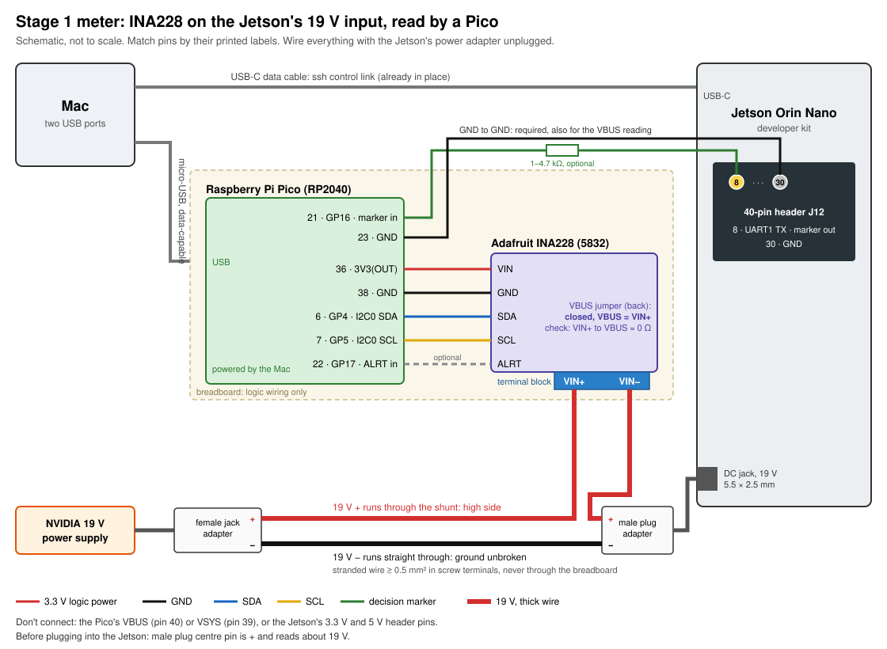

# Stage 1 meter: wiring

*Written 26 Oct 2026. Built 29 Oct, in use since 30 Oct with the marker on
pin 8 (session reports in `traces/stage1_20261029/`, `traces/stage1_20261030/`,
`traces/stage1_20261030_fix/`).* Why this meter exists: `exploration.md` §4,
Stage 1.

The INA228 sits in the + line of the Jetson's 19 V input, on the high side.
The Pico reads it over I²C, powered from the Mac's USB, and timestamps a byte
the Jetson writes on its UART at each control decision, so power and decisions
share one clock.

## Connections

| From | To | Wire |
|---|---|---|
| Pico pin 36, 3V3 (the datasheet calls it 3V3(OUT)) | INA228 VIN | red, breadboard |
| Pico pin 38, GND | INA228 GND | black, breadboard |
| Pico pin 6, GP4 (I2C0 SDA) | INA228 SDA | blue, breadboard |
| Pico pin 7, GP5 (I2C0 SCL) | INA228 SCL | yellow, breadboard |
| Pico pin 22, GP17 | INA228 ALRT | optional, breadboard |
| Jetson header pin 8, UART1 TX (`/dev/ttyTHS1`) | Pico pin 21, GP16 | female–male jumper. A 1–4.7 kΩ series resistor is optional but safer (see "Marker wire" below) |
| Jetson header pin 30, GND | Pico pin 23, GND | female–male jumper |
| supply → female adapter **+** | INA228 terminal **VIN+** | red stranded wire |
| INA228 terminal **VIN−** | male adapter **+** | red stranded wire |
| female adapter **−** | male adapter **−** | black stranded wire, straight through |
| male adapter plug | Jetson DC jack | |
| Pico micro-USB | Mac | data-capable cable |

Pin locations:

- **Pico:** the pin names are printed only on the underside, so on the
  breadboard you count. **Seen from the top** (chip side up, USB connector at
  the top):
  - left column, top to bottom, pins 1–20: GP0, GP1, GND, GP2, GP3, **GP4**,
    **GP5**, GND, … GP15. So SDA and SCL are the 6th and 7th from the top.
  - right column, top to bottom, pins 40–21: VBUS, VSYS, **GND**, 3V3_EN,
    **3V3**, ADC_VREF, … ending with **GND**, **GP17**, **GP16** at the bottom.
    So GND (38) and 3V3 (36) are the 3rd and 5th from the top.
  - **Seen from the underside**, where the labels are, the two columns swap:
    the 3V3 pin is then on the left, 5th from the top.
  - **Pin 37, 3V3_EN, sits between GND and 3V3.** Leave it free: tied to
    ground it switches the 3.3 V off. One row off on the breadboard is the
    easy mistake here.
  - 3V3 is the output of the Pico's own 3.3 V regulator, fed from the Mac's
    USB. It powers the INA228's logic, about 1 mA, against the Pico's
    recommended limit of 300 mA for that pin.
- **Jetson header J12:** pin 1 is marked on the board. Odd pins form one row,
  even pins the other. Pin 8 is on the even row, 4th from the pin-1 end
  (2, 4, 6, 8). Pins 2 and 4 next to it are 5 V, so count carefully. Pin 30,
  ground, is on the same row, 6th pair from the end opposite pin 1 (39/40,
  37/38, 35/36, 33/34, 31/32, 29/30). Pin 8 is UART1 TX, `/dev/ttyTHS1`
  (JetsonHacks pinout; on this board it idles high at 3.43 V, 30 Oct 2026).
- **INA228:** match by the printed labels. VIN+ and VIN− are on the terminal
  block and on the header; use the terminal block for the 19 V current.

Never connect the Pico's VBUS (40) or VSYS (39) to anything, and never use the
Jetson's 3.3 V or 5 V header pins: the Pico is powered by the Mac only.

## Order of work

1. **Solder** the Pico's two 20-pin headers and the INA228's header, each with
   the pins pushed into the breadboard so they stay straight.
2. **VBUS jumper.** Measure resistance between VIN+ and VBUS. Adafruit's
   current guide says the jumper ships open (low side), but an older version
   of its text described it as closed, so check rather than assume. If it
   reads open, solder the jumper on the back closed and measure again: about
   0 Ω.
3. **Shut the Jetson down** (`ssh jetson 'sudo systemctl poweroff'`, then wait
   until its `/dev/cu.usbmodem<jetson-serial>*` device is gone) and **unplug its
   power supply**.
4. **Logic wiring** on the breadboard: the five Pico–INA228 wires.
5. **Power path:** the three stranded wires between the adapters and the
   terminal block. Tighten the screws; tug each wire.
6. **Checks, with the Jetson still unplugged:**
   - continuity: female + to VIN+, VIN− to male +, female − to male −;
   - no short: male + to male − reads open;
   - plug the supply into the female adapter, leave the male plug free: its
     centre pin reads **about +19 V against its sleeve**. Unplug the supply
     again.
7. **Plug the Pico into the Mac.** The INA228's green LED lights. The Pico
   already runs MicroPython (SETUP_NOTES §8.2); check it answers with
   `mpremote connect id:<pico-serial> exec "print('ok')"`.
8. **Marker wires:** Jetson pin 8 to Pico GP16 and Jetson pin 30 to Pico GND,
   with the Jetson still off.
9. **Power up:** male plug into the Jetson, then the supply into the female
   adapter.

If anything doesn't match, stop and note what you saw.

## Marker wire

The marker is pin 8, UART1 TX, not pin 29 as first planned. Pin 29's pad is
tristated on this JetPack (`soc_gpio32_pq5`, `tristate=1`): `gpioset` changes
nothing and the header reads about 0 V. Making it drive needs NVIDIA's
`jetson-io`, which writes a device-tree overlay and adds a boot entry in
`/boot/extlinux/extlinux.conf` that becomes the default. The USB console shows no boot menu, so a bad
boot entry couldn't be undone from the Mac. Pin 8 needs no board change
(`traces/stage1_20261030/pin29_problem.md`, `traces/stage1_20261030_fix/report.md`).

How the marker works:

- The Jetson writes one `0xFF` byte to `/dev/ttyTHS1` at 115200 8N1 per
  event. The line idles high; `0xFF` leaves only the start bit low, so each
  byte gives one falling edge at its start, and the Pico timestamps that edge
  on GP16.
- Opening the port needs the `dialout` group (`<user>` is in it since
  30 Oct; SETUP_NOTES §9).
- The first write after opening the port is slow (35–39 µs). Write one dummy
  byte straight after opening, before anything is measured.
- After that, `write()` costs 5–12 µs in a bare loop (p50 11.8 µs at
  100 Hz, 5.1 µs at 1 kHz) and 15–19 µs inside the controller (31 Oct). The
  edge follows the write with a jitter of 0.6–1.4 µs (sd). Pin 8 passed
  6000/6000 edges at 100 Hz and 10000/10000 at 1 kHz.
- One byte frame takes 87 µs. A second byte for the end of a decision would
  arrive late for decisions shorter than that, so mark only the start of each
  decision, and mark every controller the same way so the marker's own cost
  cancels in comparisons. Block boundaries are pauses in the marker stream.

Both sides are 3.3 V logic, so a direct wire works. The Jetson drives the pin
and the Pico only listens. A series resistor limits the current in two fault
cases; without one, these two rules do that job:

- **GP16 is never an output while the marker wire is connected.** The Pico's
  bring-up test drove GP16 itself to check the edge capture. A test like that
  runs only with the marker wire unplugged; with the Jetson also driving the
  pin, the two outputs would fight.
- **Take the marker wire off GP16 before unplugging the Pico.** Pin 8 idles
  high (3.43 V) whenever the Jetson runs, so with the Pico unpowered it would
  feed current into the Pico through its input.

A 1–4.7 kΩ resistor in series makes both cases safe; it's optional, and none
is fitted (31 Oct 2026). With the Pico input's few pF, even 4.7 kΩ delays the
edge by well under 0.1 µs, and the delay is the same for every decision.

**Connect the marker wire before the Jetson powers up,** with the Pico already
on USB. Plugging it in during a capture bounces: on 31 Oct, about 200 edges
overflowed the Pico's edge FIFOs, which offset every later edge timestamp in
that capture. If it happens, restart the capture.

## Bench test without the Jetson

The Pico and INA228 can be tested before the Jetson is connected:

- **Without the 19 V supply:** the INA228 answers, its noise floor, read speed
  and conversion-ready signal.
- **With the 19 V supply and nothing on the male adapter:** add a temporary
  jumper from the female adapter's **−** terminal to INA228 **GND**, with the
  supply unplugged. Without the Jetson there's no other ground path, and the
  bus-voltage reading floats. **Remove this jumper before the Jetson is
  connected**, or part of the Jetson's return current would flow through the
  jumper wires and the Pico.
- **With a known load:** a resistor of 4.7 kΩ or more across the male
  adapter's + and − (about 4 mA, 77 mW: fine for a ¼ W resistor). Below
  1.5 kΩ, a ¼ W resistor overheats at 19 V.

While the supply is plugged in, the INA228's VIN+, VIN− and VBUS header pins
are at 19 V. Keep loose wires away from them: 19 V on SDA, SCL or 3V3 would
destroy the Pico. Thin jumper wire in the terminal block is fine for these
milliamp tests, not for the Jetson.

## Not verified yet

- **A faster marker.** A higher baud rate would shorten the 87 µs frame, if
  the Tegra UART supports it. Not checked.
- **Ground currents.** The Jetson and the Mac are already joined through the
  USB-C cable's ground; the extra GND wire is needed by the INA228's bus-voltage
  reading. The 19 V return current flows in the thick black wire, not the
  jumper wire. Not measured directly.
